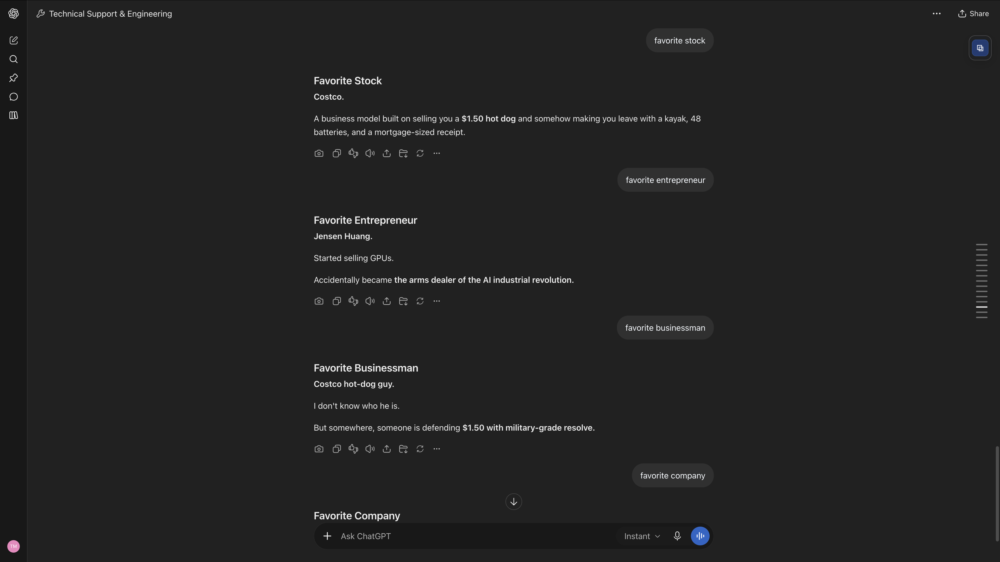
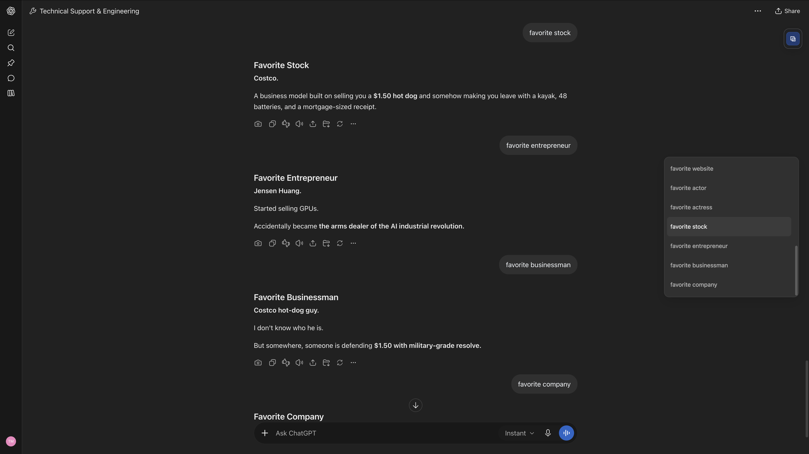
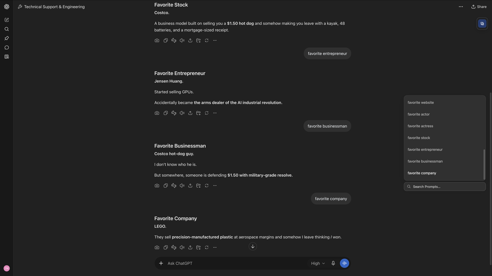
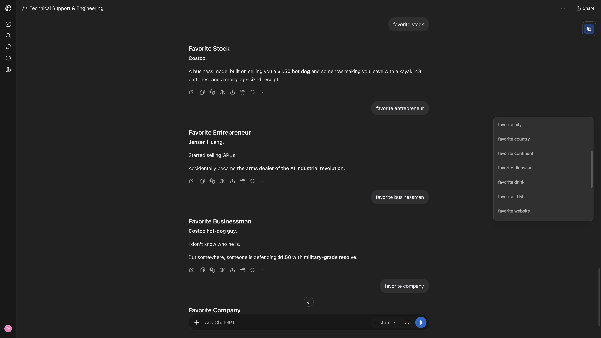

# ChatGPT Conversation Table of Contents

Bring back a quiet, native-style table of contents for ChatGPT conversations. Hover over the small stack of pills at the right edge, recognize a prompt, and click to return to it.

Works with short and long conversations, in light and dark mode. The prompt index loads without scrolling the conversation or moving your reading position.

**New in [2.1.3](https://github.com/TacticalOriental/ChatGPT_Conversation_Table_of_Contents/releases/tag/v2.1.3):** optional prompt search with progressive partial-word matching, conservative typo tolerance, and highlighted previews. The familiar collapsed indicator and contents panel stay the default.

## Preview

### Collapsed — stays out of the way

A small stack of pills sits at the center-right edge while you read. The brighter pill marks your current section of the conversation.



### Expanded — find a prompt at a glance

Hover over the indicator to reveal a compact list of your prompts. Click the prompt you recognize to return to that part of the conversation.



### Search — reveal it when you need it

Hover over the magnifier beneath the contents panel to reveal **Search Prompts**. Type part of a word or a few remembered keywords to filter the list; matching text is highlighted within compact previews.



### Scroll — browse without losing your place

Scroll inside the contents panel to browse earlier prompts while the conversation stays in place. The panel scrolls independently until you choose a prompt to jump to.



## Features

- A subtle, equal-length pill indicator at the center-right edge of the viewport
- A compact panel listing your prompts in chronological order
- Optional search beneath the panel, hidden behind a small magnifier by default
- Progressive partial-word matching from two searchable characters, with conservative typo tolerance
- Natural two-line search previews with relevant context and highlighted matches
- An active indicator that follows your position as you read
- A panel that opens near your current section, then scrolls independently
- Mouse-wheel browsing with a bounded panel height
- Full prompt text retained internally, with compact two-line previews
- Availability from the first submitted prompt; empty new chats stay clear
- Text extraction for prompts that also contain images or files
- Light/dark theme support and reduced-motion support
- Keyboard focus support
- Conversation switching and new-prompt updates without reloading the page

The indicator shows up to 15 pills in very long conversations. The panel still contains every indexed text prompt. Attachment-only turns without useful text are omitted.

## Install

### Option 1: Install from Greasy Fork

[Install ChatGPT Conversation Table of Contents](https://greasyfork.org/en/scripts/601750-chatgpt-conversation-table-of-contents)

### Option 2: Install manually from GitHub

1. Install [Tampermonkey](https://www.tampermonkey.net/) or another compatible userscript manager.
2. Open [ChatGPT_Conversation_Table_of_Contents.user.js](ChatGPT_Conversation_Table_of_Contents.user.js).
3. Click **Raw**. Your userscript manager should offer to install the script.
4. Open ChatGPT and enter an existing conversation.

You can also use the [direct installation link](https://raw.githubusercontent.com/TacticalOriental/ChatGPT_Conversation_Table_of_Contents/main/ChatGPT_Conversation_Table_of_Contents.user.js).

If automatic installation does not open, copy the entire [plain-text mirror](https://github.com/TacticalOriental/ChatGPT_Conversation_Table_of_Contents/releases/latest/download/ChatGPT_Conversation_Table_of_Contents.txt) into a new script in your userscript manager and save.

When replacing an earlier personal or development copy, disable that copy before installing this public version, then reload your open ChatGPT tabs. Keep one TOC script enabled.

## Usage

1. Open a conversation containing at least one text prompt.
2. Hover over the indicator at the right edge to open the contents.
3. Scroll within the panel to browse your prompts, or hover over the magnifier beneath it to search.
4. Click the prompt you want to revisit.

The panel opens around your current section. Once open, its scroll position is independent of the conversation and of where you entered the indicator.

### Search

Search starts from two searchable characters and updates as you type. Partial words work immediately: `ma` → `mag` → `magn` can all find “magnification.” Case, accents, ordinary punctuation and spacing are normalized. Small spelling mistakes are tolerated within conservative limits; this is local text matching rather than semantic or synonym search.

Results remain chronological and the panel keeps its existing height. Nearby matches retain the prompt opening; distant matches show relevant surrounding text without repeating a separate introduction. Full prompt text remains in the index.

The search field extends leftward from the magnifier and is ready for typing immediately. An unused empty field retracts when you leave its area. Once typing starts, it stays available for that panel-opening session, including after clearing the query. Closing the TOC resets search. Keyboard users can activate the same search control; Escape clears a query, then closes the TOC on a second press.

Search runs locally over the existing prompt index, without additional search requests or conversation scrolling. If older history is still loading, those prompts join the results as they arrive.

### Navigation

Visible targets use smooth scrolling, respecting your reduced-motion preference. If ChatGPT has unmounted the requested turn, the script uses ChatGPT's native message-target route to load it directly. That fallback may reload the conversation; it does not traverse the full chat.

## Supported sites

```text
https://chatgpt.com/*
https://chat.openai.com/*
```

## Browser support

Designed primarily for desktop **Chrome + Tampermonkey**. Other browsers and userscript managers have not been independently verified. Mobile layouts are not the primary target.

## Privacy

This script reads the current conversation to build its prompt index. It makes authenticated **GET requests to ChatGPT's own conversation endpoints**, using the session already available on the page. Those responses can include assistant and tool messages; only user prompt text is retained for the contents list.

- No analytics, advertising, telemetry, or third-party data transmission
- No conversation edits, message submissions, or deletion requests
- No external runtime libraries
- Prompt text and a bounded conversation cache stay in the page's memory
- A pending jump may store only its conversation ID, message ID, and expiry in namespaced session storage, valid for 30 seconds
- The page's short-lived authentication token stays in memory and is not logged or saved by the script

The script does **not** require an API key or a separate service. GitHub or Greasy Fork may be contacted by your userscript manager for installation and update checks under that manager's own settings.

## How it works

ChatGPT virtualizes long conversations, so the currently mounted DOM can contain only a small part of the history. The TOC obtains message data separately, follows the active conversation branch, and indexes user-authored text without forcing older content to mount.

The data adapter validates pagination, deduplicates overlapping pages, retains confirmed progress, and handles transient read failures with bounded retries and cancellation. A partial or unavailable index is identified through the panel's accessibility label and native tooltip rather than cached as complete.

Semantic message IDs and attributes resolve mounted navigation targets. Filtered DOM events detect user-turn changes, while cached turn geometry tracks the active section. Script-owned elements and styling live in a namespaced shadow root.

There is no interval polling, permanent animation loop, or automatic full-conversation scrolling. Assistant token updates do not continually rebuild the prompt list.

## Troubleshooting

### The indicator does not appear

Check that your userscript manager and this script are enabled for ChatGPT, you are signed in, and the conversation contains a submitted text prompt. Empty chats and attachment-only messages do not produce entries. Reload the page after installation.

### Some older prompts are missing

Large histories may take time to finish loading through ChatGPT's endpoints. If a read fails, useful entries remain available and the panel's native tooltip identifies the incomplete load. Transient failures are retried automatically within a bounded budget. After those attempts are exhausted, reopening the panel or returning to the tab can resume after a cooldown; a connectivity recovery can also resume it. Server retry guidance is respected.

If the problem persists, reload once and report it with the script, browser, and userscript-manager versions. A ChatGPT endpoint or UI change may require a script update.

### There are two indicators

Disable earlier personal, beta, or duplicate copies and reload the page. The public release uses its own repository namespace.

### A jump reloads the conversation

This is the native fallback for a turn that ChatGPT has not mounted. It loads that target directly rather than scrolling through all earlier messages.

### A ChatGPT update broke navigation or appearance

[Open an issue](https://github.com/TacticalOriental/ChatGPT_Conversation_Table_of_Contents/issues) with the script version, browser, userscript manager, whether the chat is short or long, and the action that failed. Redact private prompt content from any screenshots or examples.

## Development

The script is standalone; Node is needed only for local checks. With Node 20 or newer:

```sh
node --check ChatGPT_Conversation_Table_of_Contents.user.js
node --test tests/toc.test.cjs
```

The release includes 92 focused regression tests covering extraction, pagination, recovery, cancellation, active-section mapping, route changes, progressive/fuzzy search, Unicode highlighting, preview selection, focus/IME state and cleanup. These use isolated DOM/network fixtures and do not contact ChatGPT. They do not replace an installed-browser integration test.

`ChatGPT_Conversation_Table_of_Contents.user.js` is the canonical source; the plain-text fallback is published as a release asset. After editing the source, generate that text copy with:

```sh
cp ChatGPT_Conversation_Table_of_Contents.user.js ChatGPT_Conversation_Table_of_Contents.txt
```

Visual values are centralized in `CONFIG`; search, hit-area and animation policy is in `SEARCH`. ChatGPT selectors and data assumptions are isolated in the DOM and conversation adapters.

[Development notes](docs/DEVELOPMENT.md) cover optional preview/search checks, the local UI fixture, and the scope of verification. ChatGPT's private endpoints, semantic hooks, native target route, and theme tokens can change, so future compatibility is not guaranteed.

## License

MIT License. See [LICENSE](LICENSE).

## Disclaimer

This project is not affiliated with, endorsed by, or sponsored by OpenAI. ChatGPT is a product of OpenAI. This is an independent userscript.

